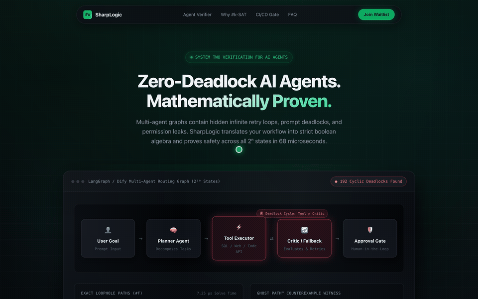

<div align="center">

# SharpLogic (♯∧)

### The Deterministic Invariant & Payment Clearance Gate for AI Agents

**Never let probabilistic LLMs approve irreversible downstream actions.**  
Bring zero-hallucination mathematical verification to financial disbursements, contractual caps, and cloud permissions.

[](https://sharplogic.vercel.app/?code=ETH-2026)
[](LICENSE)
[](https://sharplogic.vercel.app)
[](src/lib.rs)
[](tests/)

<br />



</div>

---

> [!IMPORTANT]
> **"Something downstream becomes hard to reverse — any probabilistic model gets blocked."**  
> Enterprises love AI demos, but CFOs and Legal Counsel will never grant probabilistic LLMs unconstrained authority to disburse funds, execute settlements, or relax security policies.  
> **SharpLogic bridges this chasm:** LLMs extract unstructured reality into formal tuples, while SharpLogic's native Rust SMT/`#k-SAT` engine enforces deterministic mathematical invariants over those tuples — in microseconds on the native engine. If `#F > 0`, the gate's verdict is BLOCK: the integrating system halts the downstream action and routes it to a human queue.

---

## ⚡ The Dual-Engine Architecture

Instead of trusting a 99.2% prompt evaluation to execute financial transactions, SharpLogic separates extraction from invariant verification:

```
[Unstructured Real World: Messy Invoices, Vendor Emails, Slack Chats]
                               │
                               ▼
        Layer 01: Probabilistic LLM Fact Extractor (your stack —
        SharpLogic ships no extractor; it verifies the tuples)
        Extracts formal tuples: (PO #, Invoiced Qty, Unit Price, Vendor TIN)
                               │
                               ▼
     Layer 02: SharpLogic SMT Symbolic Clearance Gate (Rust Native)
        Evaluates boolean invariants over the extracted facts in
        < 10 µs on the native engine (AP benchmark: 22 boolean
        variables, 18 invariants):
        • Price-variance flag (> 5% drift, computed by Layer 01) set
          without Procurement Director signature?
        • Remittance bank routing matches ERP Master Profile?
        • OFAC/AML screening flag and 90-day duplicate flag cleared?
                               │
           ┌───────────────────┴───────────────────┐
           ▼                                       ▼
  [ #F = 63 Loophole Paths ]              [ #F = 0 (UNSAT Core) ]
  🚨 GATE VERDICT: BLOCK                   ✓ GATE VERDICT: CLEAR
  • Your AP system holds the wire batch   • Exact-count audit record your
  • Case alerts human director queue        auditors can reproduce locally
                                          • Your ERP releases the batch
```

---

## 🏛️ Mission-Critical Enterprise Playbooks

| Playbook | The Downstream Catastrophe | SharpLogic SMT Invariant Gate | Commercial Value |
|---|---|---|---|
| **AP 3-Way Match Clearance** *(Live in Demo)* | 15%~25% non-standard invoices (price drift, unapproved freight). LLM hallucinates discount from supplier email, triggering irreversible $100k+ wire payouts. | Benchmark gate encodes the +5% variance rule as boolean invariants over extracted facts (the price-drift flag itself is computed by your extraction layer), plus PO baseline, warehouse GRN, and director counter-signature checks. | **$1,000 ~ $3,500/mo** per AP Department |
| **Contract Fallback Matrix Review** *(playbook concept — roadmap)* | Sales needs to close, Legal has 2-week backlog. Generic AI flags "seems similar", but an ambiguous *"may"* vs *"shall"* triggers millions in uncapped liability. | Concept: evaluate terms against a corporate Fallback Matrix state machine; greenlight compliant clauses, block deviations. No contract scenario or code ships today. | **$20k ~ $40k/yr** in Legal Budget Saved |
| **SOC 2 / ISO 27001 Access Snaps** *(playbook concept — roadmap)* | Big 4 auditors reject black-box LLM summaries; they want deterministic, reproducible proof of PR approvals and IAM boundaries instead. | Concept: verify access graphs before merge and export the exact-count witness trace as auditor evidence. No snapshot sealing or CI deployment block ships today. | **Non-Negotiable** Compliance Gate |

---

## 💼 Open-Core Model: Community vs. Enterprise Sentinel

| Capability | Community Edition (GitHub MIT) | Enterprise Sentinel (Commercial SaaS / VPC) |
|---|---|---|
| **Rust `#k-SAT` / WMC Core** | ✅ Full Local Offline Engine | ROADMAP — not yet shipped |
| **Workflow Trap Compiler** | ✅ CLI & Python Library | ROADMAP — not yet shipped (GitHub PR Gate Bot) |
| **AP 3-Way Match Gate** | ⚠️ Hand-Authored Benchmark | ROADMAP — not yet shipped (SAP S/4HANA & NetSuite Webhooks) |
| **In-Agent Guardrail** | ✅ `AgentGuard` Runtime Hook | ROADMAP — not yet shipped (Multi-Agent Fleet Telemetry) |
| **Audit Persistence** | 128-Slot In-Memory Ring Buffer | ROADMAP — not yet shipped (Multi-Tenant Postgres Encrypted Vault) |
| **Compliance Signatures** | Plaintext Witness Trace | ROADMAP — not yet shipped (Cryptographic SOC 2 / Big 4 Proofs) |
| **Licensing** | Open Source (MIT) | Commercial Enterprise License |

> Enterprise Sentinel is a commercial roadmap tier: every Enterprise cell above is **ROADMAP — not yet shipped**. The Community column is what exists in this repository today.

---

## 🚀 Quick Start

### 1. In-Agent Runtime Middleware (`AgentGuard`)

Install the local package and guard your multi-agent workflow with zero cloud dependencies:

```python
from sharplogic import AgentGuard

WORKFLOW = {
    "nodes": ["Tool_Executor", "Critic_Fallback", "Human_Approval_Gate"],
    "terminals": ["Human_Approval_Gate"],
    "edges": [
        {"from": "Tool_Executor", "to": "Critic_Fallback", "condition": ""},
        {"from": "Tool_Executor", "to": "Human_Approval_Gate", "condition": "not tool_timeout and not execution_error"},
        {"from": "Critic_Fallback", "to": "Tool_Executor", "condition": "retry_prompt_generated and retry_count <= 3"},
        {"from": "Critic_Fallback", "to": "Human_Approval_Gate", "condition": "not retry_prompt_generated or retry_count > 3"},
    ],
}

guard = AgentGuard(graph=WORKFLOW)

# Audit graph: returns exact trap-state assignments (#F)
report = guard.audit()
assert report["exact_count"] == 0, f"Detected {report['exact_count']} deadlock states!"

# Runtime assert on edge transition before calling downstream tools
guard.assert_safe("Critic_Fallback", "Tool_Executor", state={"retry_prompt_generated": True}, retry_count=2)
```

### 2. LangGraph One-Line Adapter

```python
from sharplogic.langgraph_adapter import from_langgraph
from sharplogic import AgentGuard

# Convert existing LangGraph topology to SharpLogic formal specification
graph = from_langgraph(nodes=my_nodes, edges=my_edges, terminals=["END"])
guard = AgentGuard(graph=graph)
report = guard.audit()
```

### 3. One-Line Offline CLI Verifier

```bash
# Verify your agent JSON export locally (100% offline, zero data leaves machine):
curl -fsSL https://sharplogic.vercel.app/install.py | python3 - --graph my_agent.json
```

---

## 🔬 Benchmark Scenarios & Measured Performance

All counts are exact, brute-force-verifiable mathematical model counts of the hand-authored benchmark formulas in `python/sharplogic/scenarios.py`, evaluated dynamically by the solver. Solve times are native Rust engine figures measured locally; the hosted demo runs the same counting algorithm through the exact Python serverless kernel and answers in tens of µs.

| Workload | Variables | State Space | Trap States (#F) | Solve Time (native) |
|---|---|---|---|---|
| **AP 3-Way Match Exception Gate** | 22 | 4,194,304 | **63** (Patched $\rightarrow$ **0**) | 4.8 µs |
| **E-Commerce Promo Stacking** | 24 | 16,777,216 | **42** (Patched $\rightarrow$ **0**) | 6.2 µs |
| **LangGraph Deadlock Routing** | 20 | 1,048,576 | **192** (Patched $\rightarrow$ **0**) | 3.7 µs |
| **AWS IAM / K8s Blast Radius** | 22 | 4,194,304 | **1,920** (120x expansion) | 5.1 µs |

---

## 🧪 Build & Test Verification

SharpLogic enforces a strict dual-track testing regime across Rust and Python boundaries:

```bash
# 1. Run Rust test suite (3/3 passing)
cargo test

# 2. Run Python test suite (47/47 passing: unit, integration & property tests)
python3 -m unittest discover -s tests -v

# 3. Start local development server
python3 server.py
```

---

## 🔑 VIP Access & Early Adopter Program

- **Live Production Platform**: [https://sharplogic.vercel.app](https://sharplogic.vercel.app)
- **VIP Launch Invite Code**: `ETH-2026` (Pre-activated at `https://sharplogic.vercel.app/?code=ETH-2026`)
- Claim your Sentinel token to unlock auto-patching and live sandbox formal verification.

<div align="center">
  <sub>Built with mathematical rigor for the next generation of mission-critical AI agents.</sub>
</div>
